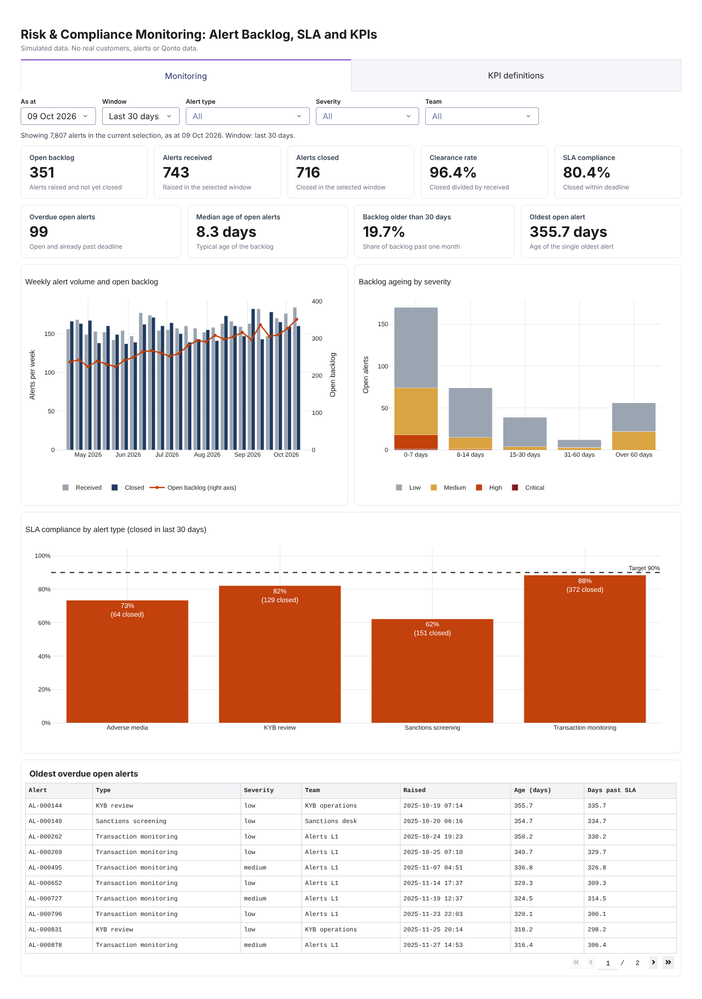
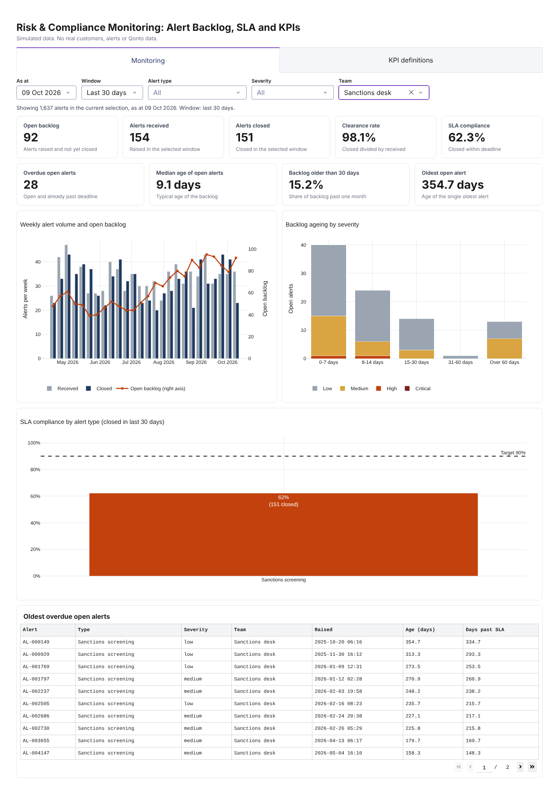

# Risk & Compliance Monitoring Dashboard: Alert Backlog, SLA and KPIs

A dashboard that tracks alert volume, backlog ageing and SLA breaches for a Risk and Compliance team, where every KPI is defined in plain language next to its exact calculation so that controllers read the same number the same way.

All data is simulated. No real customers, alerts or company data are used.



## What it shows

| Area | Question it answers |
|---|---|
| KPI tiles | How big is the backlog, how old is it, are we keeping up, are we meeting deadlines? |
| Weekly volume and backlog | Is the backlog growing because alerts are arriving faster, or closing slower? |
| Backlog ageing by severity | How much of the backlog is old, and how serious are the old alerts? |
| SLA compliance by alert type | Which queue is missing its deadline, against a 90% target? |
| Oldest overdue open alerts | Which specific alerts would an auditor ask about first? |
| KPI definitions tab | What exactly does each number mean, and what does it not tell you? |

Filters: as-at date, window (7, 30 or 90 days), alert type, severity and team.

## Run it

```bash
pip install -r requirements.txt
python app.py            # open http://127.0.0.1:8050
python -m pytest         # 28 tests
```

## The KPIs

There are nine, and each is defined once in `monitoring/definitions.py`. That single list feeds the definitions tab, the tile captions and the tests, so no KPI can appear without a definition, and the wording a controller reads is the wording that was reviewed.

Each definition has three parts: what it means in plain words, the exact calculation, and **what it does not tell you**. The third part matters most. For example:

- **SLA compliance** counts only closed alerts, so it flatters a team that closes easy alerts and leaves hard ones open. It must be read next to **overdue open alerts**.
- **Median age of open alerts** hides a long tail, which is why **oldest open alert** and the table of oldest overdue alerts sit beside it.
- **Clearance rate** can look healthy while the backlog is old and SLA compliance is poor. The screenshot below shows exactly that.



## The planted storyline

The simulator plants a problem on purpose so the dashboard has something real to find. From 1 July 2026 the sanctions desk is under-staffed and its alerts take 1.8 times longer to close.

For the sanctions desk, the dashboard shows:

- SLA compliance falling from about 91% (30 days to 30 June) to about 59% (30 days to 30 September), while the other queues stay roughly flat between 72% and 89% (adverse media is below target throughout, which is a second, quieter finding)
- the open backlog more than doubling, from 40 to 92 alerts
- a clearance rate of 98%, which looks fine on its own and is the reason it should never be read alone

A test asserts that this storyline is visible in the KPIs.

## How it is built

```
monitoring/
  config.py        SLA days, ageing buckets, target, simulation window
  definitions.py   the nine KPI definitions (single source of truth)
  simulate.py      seeded alert simulator with the planted storyline
  metrics.py       pure KPI functions: DataFrames in, numbers out, explicit as_of
  views.py         tile formatting and Plotly figures
app.py             Dash layout and one callback
tests/             28 tests
```

Design choices:

- **Metrics are pure functions with an explicit `as_of`.** Nothing reads the clock, so any past date can be reproduced exactly and tested. An alert closed after the selected day correctly counts as open on that day.
- **Validation before display.** `metrics.validate` rejects duplicate ids, nulls in mandatory columns, unknown severities and alerts closed before they were created. A wrong KPI is worse than an error.
- **Window edges are explicit.** The window start is exclusive and the end is inclusive, so consecutive windows never double count an alert.
- **Ageing buckets use whole days.** An alert exactly 8.0 days old falls in "8-14 days", and one that is 7 days and 1 second old stays in "0-7 days". Both cases are tested.
- **Empty selections do not crash.** Filtering to a combination with no alerts shows "n/a", not an error.

## Testing

The core tests use a hand-built set of ten alerts whose answers were worked out by hand: open 6, received 8, closed 3, overdue 2, SLA met 2 of 3, median age 7.5 days, oldest 48 days. Further tests cover:

- boundary cases for ageing buckets and window edges
- no look-ahead: alerts created after the selected day are invisible
- the fast weekly backlog calculation equals a brute-force count at every week
- every KPI has a complete definition, and every definition is calculated
- rendering for many dates, filters and empty selections

The tests were also checked by deliberately introducing three bugs (an inclusive window start, a look-ahead error and an ageing off-by-one); each was caught.

## Limitations

- The data is simulated. Real alert queues have bursts, weekend effects, reassignments and reopened alerts that are not modelled.
- SLA deadlines are calendar days from creation. Business days, public holidays and pauses while waiting for a customer are not modelled.
- The target (90%), the SLA days per severity and the 30 day staleness threshold are illustrative, not regulatory.
- About 1% of alerts are never picked up, which produces a tail of very old alerts. That is deliberate, to show why the oldest alert matters, but real data would need a rule for stale or orphaned alerts.
- A single seed gives a single scenario. The dashboard reads from an in-memory DataFrame; a real deployment would read from a warehouse table.
